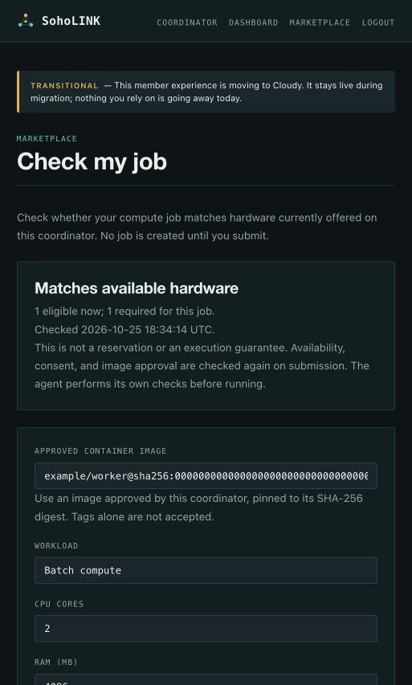
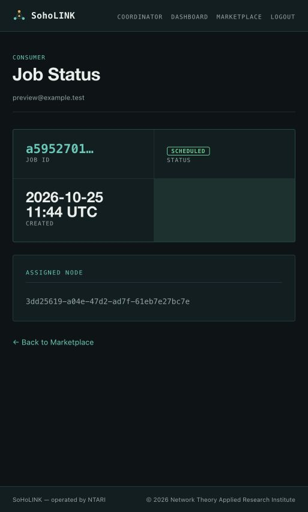

# Conformance — Janus-Facing Architecture

The repo's self-description in the architecture's own terms, stated **before** anything product- or deployment-specific, per the architecture's ordering rule. Every conformance claim is bound to the mechanism and check that enforces it, or it is labeled a stand-in. Unbound prose is marketing.

The architecture is **Janus-Facing Architecture (JFA)** — NTARI's unified architecture document, free documentation under the project's AGPL-3.0 commons. It names roles, never products; this repo declares which role it fills.

## Role declaration

SoHoLINK is the **coordinator** of a JFA **substrate**: node-side orchestration — node recognition via capability listings, matching and scheduling, the employment lifecycle, fee declarations, fiat settlement, dispute handling — and federation of front ends. The coordinator is a **pluggable role**: any conformant implementation may replace it, and a front end may run its own or match directly against nodes. The substrate guarantee it serves: **coordination on infrastructure participants can own — no unremovable hosting chokepoint.**

| This repo's term | Architecture role |
|---|---|
| Coordinator (this repo) | the coordinator: node-side orchestration, pluggable, replaceable |
| Frontend (Cloudy et al.) | a front end: the member-facing application; where members and the member economy live |
| Node | participant-owned infrastructure |
| `participants` table, portal, agent | **transitional member surfaces** — front-end-owned capabilities hosted here pending migration, labeled as such in CLAUDE.md |

## Invariants and their bindings

| Invariant (architecture) | Mechanism here | Check |
|---|---|---|
| **Persons never appear on the wire** | Long-term the coordinator models no persons: counterparties are front ends and nodes; wire identity is workload identity (SPIFFE NodeID) via `sohocloud-protocol` | Protocol consumed at published tag; transitional person-surfaces labeled, not denied |
| **Single participant identity** | One `participants` table (migration 011) — no provider/consumer split exists in the schema or code | Schema; grep for `providers`/`consumers` returns only the migration history |
| **Fee legibility** | Fees exist only as coordinator-signed `FeeDeclaration` messages — authored, legible, contestable | Protocol `fees/` package + SPEC |
| **Fiat stays fiat; credit stays home** | Settlement is pure fiat (Stripe Connect); no tokens, no wallets; strictly separate from any front end's member-issued credit | CLAUDE.md invariant; payment package touches Stripe only |
| **No information asymmetry** | Pricing, metering, and earnings visible to all participants | Portal surfaces; metering tables |
| **Placement legibility** | Compute preflight shares image validation and registry predicates with submission; portal checks the live registry over the private API; returns aggregate first-failure reasons, without node/owner identifiers; own nodes stay excluded | `TestMatchExplanationUsesPlacementFilters`, `TestMatchExplanationHidesOwnAndExcludedNodes`, `TestJobCheckRendersRealEligibilityWithoutIdentities`, `TestPreflightThroughInternalClient` |
| **Governance surface separated** | Admin portal on a separate local-only port, never exposed publicly, not role-flags on the public portal | Deploy configuration |
| **Provenance inbound = outbound** | AGPL-3.0; DCO (`Signed-off-by` per commit), no CLA | License; DCO workflow (see stand-ins: enforcement suspended as a named interim) |

## Stand-ins and open residuals

- **Transitional member surfaces.** The node agent, member portal, `participants` table, and installer are front-end-owned capabilities hosted here from the dual-role era, pending migration. They are labeled, kept working, and never described as the coordinator's long-term role.
- **Coordinator federation is a design target, not built.** Witnessed checkpoints (the certificate-transparency model reserved in the record layer and the protocol's `anchor/` stub) are the named target for cross-coordinator non-equivocation. Until then, this is a single-coordinator deployment: the architecture's open problem 7 — sovereign compute buys mechanical, not economic, exit — applies in full and is named, not solved.
- **Frontend-as-operator authentication — BUILT on the coordination wire.** The `/v0` node-side surface and node-pubkey enrollment now accept a 2-of-7 operator transmission (rotating seven-key set, `X-SohoCloud-Operator` header, per-`(operator,coordinator)` replay window) via an operator-or-SPIFFE selector: the header selects the operator path; its absence keeps the existing SPIFFE path for direct/satellite nodes. Node authenticity in both paths comes from each message's own ed25519 signature (verified against `node_protocol_keys`), so the operator-relay path adds no per-node SVID. Check: `OperatorAuth`/`OperatorOrSPIFFE` unit tests; conformance harness Suite B. Residual: no operator has completed enrollment end-to-end yet (blocked on the 2FA mail transport), so the path is verified in test, not yet in production.
- **Fiat settlement counterparty** (member's payout identity vs. front end) is a deliberately open question; either answer stays fiat-side, never conflated with member credit.
- **DCO enforcement is suspended as a named interim (2026-07-12).** The `dco.yml` workflow is disabled — not deleted — for the stack-establishment push, by decision of the steward. Per the architecture's provenance standard: the covenant itself never suspends (contributions still enter the AGPL commons inbound = outbound, Contributor Covenant unaffected); reinstatement is committed and is one action (`gh workflow enable DCO`); and the gap is honest — commits made during the window cannot be retroactively certified, so the window is kept short and its start and end are matters of record. Agent-authored commits continue to carry `Signed-off-by` throughout the window regardless.

## Dependency declaration

Consumes `sohocloud-protocol` at a published version tag — the dependency leaf both this coordinator and the front ends share. Depends on no front end and no member-economy code; the member economy lives above this layer and must not migrate down into it.

## Proposed protocol response migration

This dependency draft targets sohocloud-protocol **v0.4.0**, pending publication
and clean tagged-module verification. The reference client now requires exactly
one JSON response document. `TestReferenceClientFeeFraming` drives the client
through the real `NewHandler` fee route. The client accepts the signed declaration
with normal JSON whitespace and returns no partial result when a second value
is appended.
Protocol v0.4.0 also rejects signed messages with zero or out-of-range timestamps.
The governance fee publisher returns HTTP 400 before signing if `effective_at`
falls outside the protocol range or has finer precision than PostgreSQL can
store (microseconds). The full dependency upgrade changes listing and
assignment signatures relative to v0.1.0. The success-body budget remains
opt-in at the client.

Local candidate verification uses an external Go workspace, never a committed
`replace`. After maintainers publish v0.4.0, regenerate module checksums and run
the build, unit tests, and database integration tests without that workspace.
Confirm DCO, the CI `test` job, and the CodeQL analysis jobs and result check on
the updated pull request.

### Mixed-version release gate

SoHoLINK's previous protocol pin was **v0.1.0**. Intervening protocol
releases added GPUs, committed storage, and storage opt-in to listing canonical
bytes and GPU requirements to assignment canonical bytes under their existing
`v0` domains. Even empty new fields change signatures. Old/new peers cannot be
assumed to exchange valid listings or assignments; signed-fee round trips alone
do not prove upgrade safety.

Before deployment, agree and test a coordinated agent, frontend/relay, and
coordinator upgrade. Do not silently reinterpret stored signatures or adopt a
migration policy in this dependency PR. The protocol migration fixture records
valid v0.1.0 signatures that the candidate rejects; current candidate regression
suites exercise peers using the same version. A mixed-version deployment remains
blocked until its migration procedure is agreed and verified.

## Product-specific notes (last, per the ordering rule)

Reference deployment at soholink.org; trust domain `spiffe://soholink.org`. Cloudy is the reference front end. Neither is privileged by the protocol.

The transitional member marketplace links to **Check my job** at
`/consumer/job/check`. App hosting, batch compute, and AI inference can be
checked against the current image allowlist and registered hardware. Country,
CPU, RAM, GPU, disk, ownership exclusion, and resource opt-out checks are the
same ones used by dispatch. Each excluded node is counted at its first failed
check, so a reason count is not a separate census of all nodes failing that
condition. Own and explicitly excluded nodes are omitted entirely.

Preflight reads local coordinator state only: it does not schedule, reserve,
create jobs, generate job tokens, touch payments, or record submitted demand.
`TestJobPreflightIsReadOnlyAndRechecksAvailability` exercises it with no DB,
token secret, or scheduler. Confirmation uses `SubmitJob` again, so a preview
cannot bypass a later opt-out or image change. All new portal routes require
the existing member session. The coordinator houses the blocker-description
catalog, which the transitional frontend portal alone displays. These sentences
are presentation text, never shared protocol fields. No person fields or preview
messages are added to the shared protocol.

**Limits:** previews that cannot be placed are not counted as rejections in demand sounding.
The existing submission path uses `SLAStandard` (one node).
Readiness reports advertised eligibility, not free-resource reservation or
runtime success. Heartbeats and opt-out synchronization can lag; the agent's
local gates remain authoritative. Pricing, credit, reputation, and governance
rules are unchanged. These behavioral tests are not new Janus registry bindings
and do not certify whole-stack conformance.

### Check my job examples

The availability check shows the checked image and resource requirements before
confirmation. Confirmation submits that checked snapshot, even if the editable
check form has since changed. SubmitJob validates current availability again.
After a submission error, check the dashboard before trying again; an error may
leave the outcome unknown. Preflight requests stop when the portal request is
cancelled. Disk demand telemetry saturates at the maximum signed 64-bit MB value
instead of wrapping for unusually large accepted disk inputs.

These local examples use sample nodes; no worker executed the job.

